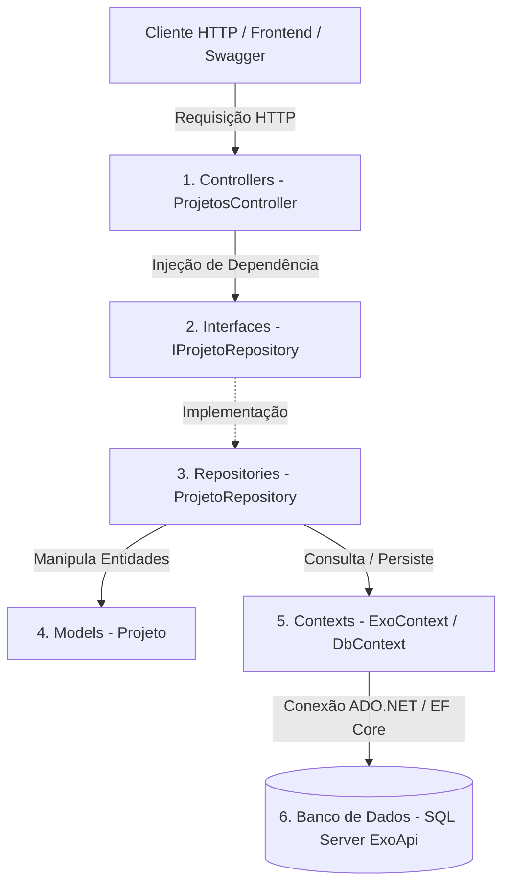

# 🚀 Exo.WebApi - API de Gerenciamento de Projetos (SENAI)

<p align="center">
  
  
  
  
  
  
</p>

---

## 📑 Sumário
1. [Sobre o Projeto](#-sobre-o-projeto)
2. [Tecnologias Utilizadas](#-tecnologias-utilizadas)
3. [Arquitetura em Camadas (Layered Architecture)](#-arquitetura-em-camadas-layered-architecture)
4. [Estrutura de Pastas e Arquivos](#-estrutura-de-pastas-e-arquivos)
5. [Banco de Dados (SQL Server)](#-banco-de-dados-sql-server)
6. [Configuração do Ambiente e Execução](#-configuração-do-ambiente-e-execução)
7. [Documentação Completa dos Endpoints (CRUD)](#-documentação-completa-dos-endpoints-crud)
   - [GET /api/projetos](#1-listar-todos-os-projetos-get)
   - [GET /api/projetos/{id}](#2-buscar-projeto-por-id-get)
   - [POST /api/projetos](#3-cadastrar-novo-projeto-post)
   - [PUT /api/projetos/{id}](#4-atualizar-projeto-existente-put)
   - [DELETE /api/projetos/{id}](#5-deletar-projeto-delete)
8. [Formas de Testar a API](#-formas-de-testar-a-api)
9. [Alinhamento com os Critérios de Avaliação do SENAI](#-alinhamento-com-os-critérios-de-avaliação-do-senai)

---

## 📖 Sobre o Projeto
O **Exo.WebApi** é um projeto prático desenvolvido como requisito avaliativo do curso técnico do **SENAI** (Desenvolvimento de Sistemas / Módulo Backend).

O sistema consiste em uma **Web API RESTful** completa voltada para a gestão e controle do ciclo de vida de projetos institucionais. A aplicação implementa persistência de dados em banco relacional e disponibiliza todas as operações essenciais do protocolo HTTP (**CRUD**: Create, Read, Update e Delete).

---

## 🛠 Tecnologias Utilizadas

| Tecnologia | Finalidade no Projeto |
|---|---|
| **.NET 8.0 (LTS)** | Plataforma de desenvolvimento moderna, estável e de alto desempenho com suporte de longo prazo da Microsoft. |
| **C# 12** | Linguagem de programação fortemente tipada e orientada a objetos utilizada para toda a lógica de negócio. |
| **ASP.NET Core Web API** | Framework web para criação de serviços HTTP RESTful eficientes, desacoplados e escaláveis. |
| **Entity Framework Core 8** | ORM (*Object-Relational Mapping*) para mapeamento e manipulação de entidades no banco de dados via código C#. |
| **Microsoft SQL Server / SQLEXPRESS** | Sistema de Gerenciamento de Banco de Dados Relacional (SGBD) onde as tabelas e registros ficam persistidos. |
| **Swagger / OpenAPI (Swashbuckle)** | Ferramenta de documentação interativa que permite inspecionar, testar e documentar os endpoints no navegador. |
| **CORS (Cross-Origin Resource Sharing)** | Mecanismo configurado no pipeline para permitir o consumo da API por clientes frontend (React, Angular, Vue, etc.). |
| **Git & GitHub** | Controle de versionamento de código e publicação em repositório público para avaliação. |

---

## 🏛 Arquitetura em Camadas (Layered Architecture)

O projeto foi rigorosamente estruturado segundo as boas práticas de engenharia de software e arquitetura em camadas, respeitando os princípios de separação de responsabilidades e **SOLID**:



### Detalhamento das Camadas:

1. **Camada de Controladores (`Controllers/`):**
   - Responsável por receber as requisições HTTP (`GET`, `POST`, `PUT`, `DELETE`).
   - Valida o payload através de `ModelState` e anotações.
   - Retorna as respostas com os códigos de status HTTP corretos e semânticos (`200 OK`, `201 Created`, `204 NoContent`, `400 Bad Request`, `404 NotFound`).

2. **Camada de Contratos (`Interfaces/`):**
   - Define a interface `IProjetoRepository` com a assinatura de todos os métodos de persistência.
   - Garante o Princípio da Inversão de Dependência (DIP - SOLID), permitindo que a Controller dependa de uma abstração e não de uma implementação concreta.

3. **Camada de Acesso a Dados (`Repositories/`):**
   - Implementa a interface `IProjetoRepository`.
   - Centraliza todas as operações com o Entity Framework Core (`Add`, `Update`, `Remove`, `Find`, `ToList`, `SaveChanges`), isolando a regra de persistência da Controller.

4. **Camada de Domínio / Entidades (`Models/`):**
   - Contém a classe `Projeto.cs`, representando os dados de um projeto com propriedades: `Id`, `NomeDoProjeto`, `Area` e `Status`.
   - Contém validações declarativas com `[Required]` e `[StringLength]`.

5. **Camada de Contexto e ORM (`Contexts/`):**
   - Contém a classe `ExoContext.cs` herdando de `DbContext`.
   - Realiza o mapeamento relacional da entidade `Projeto` para a tabela `Projetos` do SQL Server.

---

## 📂 Estrutura de Pastas e Arquivos

```
Projeto-ExoApi/
│
├── 📁 Controllers/
│   └── ProjetosController.cs         # Endpoints REST com status HTTP semânticos (200, 201, 400, 404, 409, 500)
│
├── 📁 Exceptions/
│   ├── ProjetoNaoEncontradoException.cs # Exceção customizada (Status 404 Not Found)
│   ├── ProjetoDuplicadoException.cs     # Exceção customizada (Status 409 Conflict)
│   └── DadosInvalidosException.cs       # Exceção customizada (Status 400 Bad Request)
│
├── 📁 Interfaces/
│   └── IProjetoRepository.cs         # Contrato com assinaturas dos métodos
│
├── 📁 Models/
│   ├── Projeto.cs                    # Entidade de domínio com Data Annotations
│   └── ApiResponse.cs                # Classes padronizadas ApiResponse<T> e ApiErrorResponse
│
├── 📁 Contexts/
│   └── ExoContext.cs                 # Contexto de persistência do Entity Framework Core
│
├── 📁 Repositories/
│   └── ProjetoRepository.cs          # Implementação das regras de CRUD e lançamento de exceções
│
├── 📁 Scripts/
│   └── ExoApi_Script.sql             # Script SQL de criação do banco e dados iniciais
│
├── 📁 Properties/
│   └── launchSettings.json           # Configuração de portas e ambiente (localhost:5000)
│
├── 📄 ExoApi.postman_collection.json # Coleção completa de testes para importação no Postman
├── 📄 Exo.WebApi.http                # Coleção de testes de requisição HTTP prontos (VS Code)
├── 📄 appsettings.json               # Configurações gerais e Connection String do SQL Server
├── 📄 appsettings.Development.json   # Configurações específicas de desenvolvimento
├── 📄 Program.cs                     # Ponto de entrada, injeção de dependências e pipeline
├── 📄 Exo.WebApi.csproj              # Arquivo de dependências e pacotes NuGet do .NET 8
├── 📄 README.md                      # Documentação completa do projeto
└── 📄 .gitignore                     # Configuração para ignorar bin/, obj/ e temporários
```

---

## 🗄 Banco de Dados (SQL Server)

O projeto armazena seus dados em um banco chamado `ExoApi` no **SQL Server** (ou **SQL Server Express**).

### Script de Criação e Dados de Teste
O script SQL completo está disponível no arquivo [`Scripts/ExoApi_Script.sql`](file:///c:/Users/Asus/Desktop/API_SENAI_NTERACAO/Projeto-ExoApi/Scripts/ExoApi_Script.sql):

```sql
-- 1. Criação da Base de Dados
CREATE DATABASE ExoApi;
GO

USE ExoApi;
GO

-- 2. Criação da Tabela Projetos
CREATE TABLE Projetos (
    Id INT IDENTITY(1,1) PRIMARY KEY,
    NomeDoProjeto VARCHAR(150) NOT NULL,
    Area VARCHAR(100) NOT NULL,
    Status BIT NOT NULL
);
GO

-- 3. Carga Inicial de Testes (Seed Data)
INSERT INTO Projetos (NomeDoProjeto, Area, Status) VALUES
('Portal Educacional Conectado', 'Educação e Tecnologia', 1),
('Sistema de Logística Reversa Inteligente', 'Sustentabilidade', 1),
('Automação de Linha de Produção Industrial', 'Mecatrônica', 0);
GO
```

> **Nota:** A aplicação também conta com `context.Database.EnsureCreated()` configurado no `Program.cs`, garantindo que caso o banco ou tabela ainda não existam, o Entity Framework Core os crie automaticamente durante a inicialização!

---

## ⚙️ Configuração do Ambiente e Execução

### Pré-requisitos
- [.NET 8.0 SDK](https://dotnet.microsoft.com/download/dotnet/8.0) instalado.
- [SQL Server](https://www.microsoft.com/sql-server/) ou **SQL Server Express** ativo na máquina local.
- Git instalado.

### 1. Clonar o Repositório
```bash
git clone https://github.com/Carlos-niell/Exo-api.git
cd Exo-api
```

### 2. Configurar a String de Conexão
Se necessário, ajuste a string no arquivo [`appsettings.json`](file:///c:/Users/Asus/Desktop/API_SENAI_NTERACAO/Projeto-ExoApi/appsettings.json):
```json
{
  "ConnectionStrings": {
    "ExoApiDatabase": "Server=localhost\\SQLEXPRESS;Database=ExoApi;Trusted_Connection=True;TrustServerCertificate=True;"
  }
}
```

### 3. Restaurar e Compilar
```bash
dotnet restore
dotnet build
```

### 4. Executar a API
```bash
dotnet run --launch-profile http
```
A API será inicializada na porta `5000`:
- **Documentação Swagger:** [http://localhost:5000/](http://localhost:5000/)

---

## 📡 Documentação Completa dos Endpoints (CRUD)

| Método | Endpoint | Descrição | Status Sucesso | Status Erro |
|---|---|---|---|---|
| `GET` | `/api/projetos` | Retorna todos os projetos com mensagem padronizada | `200 OK` | `500 Internal Server Error` |
| `GET` | `/api/projetos/{id}` | Busca um projeto por identificador | `200 OK` | `400 Bad Request`, `404 Not Found`, `500` |
| `POST` | `/api/projetos` | Cadastra um novo projeto | `201 Created` | `400 Bad Request`, `409 Conflict`, `500` |
| `PUT` | `/api/projetos/{id}` | Atualiza um projeto existente | `200 OK` | `400 Bad Request`, `404 Not Found`, `409 Conflict`, `500` |
| `DELETE` | `/api/projetos/{id}` | Remove um projeto pelo ID | `200 OK` | `400 Bad Request`, `404 Not Found`, `500` |

---

### 1. Listar todos os Projetos (GET)
- **Método:** `GET`
- **URL:** `http://localhost:5000/api/projetos`
- **Status de Sucesso:** `200 OK`
- **Exemplo de Resposta Padronizada (`ApiResponse<T>`):**
```json
{
  "sucesso": true,
  "mensagem": "Projetos listados com sucesso.",
  "total": 3,
  "dados": [
    {
      "id": 1,
      "nomeDoProjeto": "Portal Educacional Conectado",
      "area": "Educação e Tecnologia",
      "status": true
    },
    {
      "id": 2,
      "nomeDoProjeto": "Sistema de Logística Reversa Inteligente",
      "area": "Sustentabilidade",
      "status": true
    }
  ],
  "dataHora": "2026-11-01T22:00:00Z"
}
```

---

### 2. Buscar Projeto por ID (GET)
- **Método:** `GET`
- **URL:** `http://localhost:5000/api/projetos/1`
- **Status de Sucesso:** `200 OK`
- **Exemplo de Resposta Padronizada (`ApiResponse<T>`):**
```json
{
  "sucesso": true,
  "mensagem": "Projeto localizado com sucesso.",
  "dados": {
    "id": 1,
    "nomeDoProjeto": "Portal Educacional Conectado",
    "area": "Educação e Tecnologia",
    "status": true
  },
  "dataHora": "2026-11-01T22:00:00Z"
}
```

---

### 3. Cadastrar novo Projeto (POST)
- **Método:** `POST`
- **URL:** `http://localhost:5000/api/projetos`
- **Headers:** `Content-Type: application/json`
- **Corpo da Requisição (Body):**
```json
{
  "nomeDoProjeto": "Sistema de Gestão de Frotas Elétricas",
  "area": "Transporte Sustentável",
  "status": true
}
```
- **Status de Sucesso:** `201 Created`
- **Header Location:** `http://localhost:5000/api/projetos/4`
- **Exemplo de Resposta:**
```json
{
  "sucesso": true,
  "mensagem": "Projeto cadastrado com sucesso!",
  "dados": {
    "id": 4,
    "nomeDoProjeto": "Sistema de Gestão de Frotas Elétricas",
    "area": "Transporte Sustentável",
    "status": true
  },
  "dataHora": "2026-11-01T22:00:00Z"
}
```

---

### 4. Atualizar Projeto existente (PUT)
- **Método:** `PUT`
- **URL:** `http://localhost:5000/api/projetos/1`
- **Headers:** `Content-Type: application/json`
- **Corpo da Requisição (Body):**
```json
{
  "id": 1,
  "nomeDoProjeto": "Portal Educacional Conectado - Versão 2.0",
  "area": "Tecnologia e Inovação",
  "status": true
}
```
- **Status de Sucesso:** `200 OK`
- **Exemplo de Resposta:**
```json
{
  "sucesso": true,
  "mensagem": "Projeto atualizado com sucesso!",
  "dados": {
    "id": 1,
    "nomeDoProjeto": "Portal Educacional Conectado - Versão 2.0",
    "area": "Tecnologia e Inovação",
    "status": true
  },
  "dataHora": "2026-11-01T22:00:00Z"
}
```

---

### 5. Deletar Projeto (DELETE)
- **Método:** `DELETE`
- **URL:** `http://localhost:5000/api/projetos/3`
- **Status de Sucesso:** `200 OK`
- **Exemplo de Resposta:**
```json
{
  "sucesso": true,
  "mensagem": "Projeto removido com sucesso!",
  "dados": {
    "idRemovido": 3
  },
  "dataHora": "2026-11-01T22:00:00Z"
}
```

---

## 🛡️ Atendimento aos Requisitos Avaliativos do SENAI

### 1. Mensagens de Sucesso Padronizadas (6,0 Pontos)
A API implementa a classe genérica `ApiResponse<T>`, padronizando todas as respostas de sucesso com as propriedades:
- `sucesso` (`bool`): Indica o êxito da requisição.
- `mensagem` (`string`): Texto amigável e específico da ação realizada.
- `dados` (`T`): Entidade ou coleção retornada.
- `dataHora` (`DateTime`): Timestamp UTC da resposta.

**Exemplos de mensagens de sucesso configuradas:**
1. **Cadastro (`POST` - 201 Created):** `"Projeto cadastrado com sucesso!"`
2. **Atualização (`PUT` - 200 OK):** `"Projeto atualizado com sucesso!"`
3. **Exclusão (`DELETE` - 200 OK):** `"Projeto removido com sucesso!"`
4. **Listagem (`GET` - 200 OK):** `"Projetos listados com sucesso."`
5. **Busca por ID (`GET` - 200 OK):** `"Projeto localizado com sucesso."`

---

### 2. Mensagens de Retorno de Erro com Códigos HTTP Adequados (8,0 Pontos)
Todas as respostas de erro utilizam a classe padronizada `ApiErrorResponse` (`sucesso`, `status`, `erro`, `mensagem`, `detalhes`, `dataHora`), cobrindo com precisão semântica os seguintes códigos HTTP:

| Código HTTP | Cenário de Aplicação | Mensagem de Retorno |
|---|---|---|
| **`400 Bad Request`** | Parâmetros inválidos (ex: ID ≤ 0), incompatibilidade de ID entre URL e corpo, ou falha de validação de modelo (`ModelState`). | `"Os dados fornecidos para o projeto são inválidos."` ou `"O identificador informado na URL deve ser maior que zero."` |
| **`404 Not Found`** | Tentativa de consultar, alterar ou excluir um projeto com ID inexistente no banco. | `"Projeto com ID {id} não foi encontrado no sistema."` |
| **`409 Conflict`** | Tentativa de cadastrar ou renomear um projeto com nome já existente (regra de unicidade). | `"Já existe um projeto cadastrado com o nome '{nome}'."` |
| **`500 Internal Server Error`** | Falhas inesperadas de servidor ou indisponibilidade de infraestrutura capturadas pelo bloco genérico. | `"Ocorreu um erro interno inesperado ao processar a operação no servidor."` |

---

### 3. Lançamento, Captura e Tratamento de Exceções (8,0 Pontos)
Foram implementadas classes de exceções personalizadas em [`Exceptions/`](file:///c:/Users/Asus/Desktop/API_SENAI_NTERACAO/Projeto-ExoApi/Exceptions) que representam falhas de domínio e negócio:

1. **`ProjetoDuplicadoException`**:
   - **Lançamento (`throw`):** Ocorre no repositório ([`ProjetoRepository.cs`](file:///c:/Users/Asus/Desktop/API_SENAI_NTERACAO/Projeto-ExoApi/Repositories/ProjetoRepository.cs)) durante o cadastro ou alteração, ao constatar que já existe projeto com o mesmo nome:
     ```csharp
     if (duplicado)
     {
         throw new ProjetoDuplicadoException($"Já existe um projeto cadastrado com o nome '{projeto.NomeDoProjeto}'.");
     }
     ```
   - **Captura (`catch`) e Tratamento:** No controlador ([`ProjetosController.cs`](file:///c:/Users/Asus/Desktop/API_SENAI_NTERACAO/Projeto-ExoApi/Controllers/ProjetosController.cs)), a exceção é capturada e tratada retornando `409 Conflict` com corpo formatado:
     ```csharp
     catch (ProjetoDuplicadoException ex)
     {
         return Conflict(new ApiErrorResponse
         {
             Status = StatusCodes.Status409Conflict,
             Erro = "Conflito de Dados",
             Mensagem = ex.Message
         });
     }
     ```

2. **`ProjetoNaoEncontradoException`**:
   - **Lançamento (`throw`):** Ocorre no repositório ([`ProjetoRepository.cs`](file:///c:/Users/Asus/Desktop/API_SENAI_NTERACAO/Projeto-ExoApi/Repositories/ProjetoRepository.cs)) ao tentar buscar, atualizar ou deletar um projeto cujo ID não existe:
     ```csharp
     if (projetoExistente == null)
     {
         throw new ProjetoNaoEncontradoException($"Projeto com ID {id} não foi encontrado.");
     }
     ```
   - **Captura (`catch`) e Tratamento:** No controlador ([`ProjetosController.cs`](file:///c:/Users/Asus/Desktop/API_SENAI_NTERACAO/Projeto-ExoApi/Controllers/ProjetosController.cs)), é capturada e tratada retornando `404 Not Found`:
     ```csharp
     catch (ProjetoNaoEncontradoException ex)
     {
         return NotFound(new ApiErrorResponse
         {
             Status = StatusCodes.Status404NotFound,
             Erro = "Não Encontrado",
             Mensagem = ex.Message
         });
     }
     ```

3. **`DadosInvalidosException`**:
   - **Lançamento (`throw`):** Lançada ao identificar parâmetros fora dos limites aceitos (ex: `id <= 0`).
   - **Captura (`catch`) e Tratamento:** Retorna `400 Bad Request` com a mensagem explicativa.

---

### 4. Semântica e Sintaxe Adequadas (4,0 Pontos)
- **Código C# 12 / .NET 8:** Organizado segundo os padrões de projeto da Microsoft (nomenclatura PascalCase/camelCase, injeção de dependências, separação de camadas).
- **Anotações Swagger:** Todos os métodos do controlador possuem documentação XML e anotações `[ProducesResponseType]` com os tipos e códigos HTTP exatos.
- **Compilação Limpa:** Projeto compila com **0 erros e 0 avisos (warnings)**.

---

## 🧪 Formas de Testar a API

### Opção 1: Via Coleção Oficial do Postman
O repositório inclui a coleção completa pronta para importação no arquivo [`ExoApi.postman_collection.json`](file:///c:/Users/Asus/Desktop/API_SENAI_NTERACAO/Projeto-ExoApi/ExoApi.postman_collection.json):
1. No **Postman**, clique em **Import** (ou `Ctrl + O`).
2. Selecione o arquivo `ExoApi.postman_collection.json`.
3. A coleção estará organizada com 10 requisições categorizadas em:
   - **🟢 Cenários de Sucesso:** Listar (`200 OK`), Buscar por ID (`200 OK`), Cadastrar (`201 Created`), Atualizar (`200 OK`), Deletar (`200 OK`).
   - **🔴 Cenários de Erro e Exceções:** Dados Inválidos (`400 Bad Request`), ID Inválido (`400 Bad Request`), ID Divergente (`400 Bad Request`), Projeto Não Encontrado (`404 Not Found`), Projeto Duplicado (`409 Conflict`).

### Opção 2: Via Swagger UI (Navegador)
Inicie a aplicação e abra:
👉 **[http://localhost:5000/](http://localhost:5000/)**  
O Swagger exibe todos os endpoints, modelos de retorno (`ApiResponse`, `ApiErrorResponse`) e códigos de status HTTP mapeados.

### Opção 3: Via Arquivo `.http` (VS Code / Visual Studio)
O arquivo [`Exo.WebApi.http`](file:///c:/Users/Asus/Desktop/API_SENAI_NTERACAO/Projeto-ExoApi/Exo.WebApi.http) contém requisições prontas com link de execução direta (`Send Request`) no editor.

### Opção 4: Via PowerShell ou cURL
```powershell
# Listar todos os projetos
Invoke-RestMethod -Uri "http://localhost:5000/api/projetos" -Method Get
```

---

## 👤 Autor
Desenvolvido por **Carlos Daniel** para o curso técnico do **SENAI**.  
Repositório Oficial: **[https://github.com/Carlos-niell/Exo-api](https://github.com/Carlos-niell/Exo-api)**

