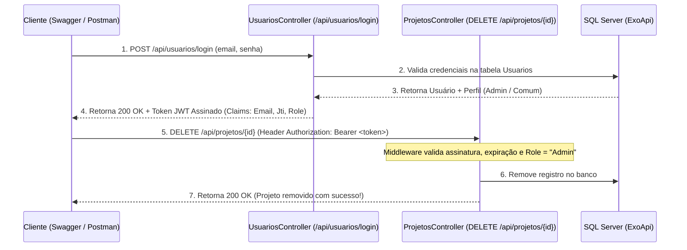

# 🚀 Exo.WebApi - API de Gerenciamento de Projetos com Autenticação e Autorização JWT (SENAI)

<p align="center">
  
  
  
  
  
  
  
</p>

---

## 📑 Sumário
1. [Sobre o Projeto](#-sobre-o-projeto)
2. [Segurança: Autenticação e Autorização (JWT)](#-segurança-autenticação-e-autorização-jwt)
3. [Tecnologias Utilizadas](#-tecnologias-utilizadas)
4. [Arquitetura em Camadas (Layered Architecture)](#-arquitetura-em-camadas-layered-architecture)
5. [Estrutura de Pastas e Arquivos](#-estrutura-de-pastas-e-arquivos)
6. [Banco de Dados (SQL Server)](#-banco-de-dados-sql-server)
7. [Configuração do Ambiente e Execução](#-configuração-do-ambiente-e-execução)
8. [Documentação Completa dos Endpoints](#-documentação-completa-dos-endpoints)
9. [Alinhamento com os Critérios de Avaliação do SENAI](#-atendimento-aos-requisitos-avaliativos-do-senai)
10. [Formas de Testar a API](#-formas-de-testar-a-api)

---

## 📖 Sobre o Projeto
O **Exo.WebApi** é um projeto prático desenvolvido como requisito avaliativo do curso técnico do **SENAI** (Desenvolvimento de Sistemas / Módulo Backend).

O sistema consiste em uma **Web API RESTful** completa voltada para a gestão e controle do ciclo de vida de projetos institucionais, contando com:
- **Autenticação via JWT (JSON Web Token):** Verificação segura da identidade dos usuários através de credenciais (`email` e `senha`) e emissão de token assinado com `HMAC-SHA256`.
- **Autorização e Controle de Permissões (`[Authorize]`):** Restrição de acesso ao endpoint sensível de exclusão (`DELETE /api/projetos/{id}` e `DELETE /api/usuarios/{id}`), permitindo que **somente usuários autenticados e autorizados (perfil `Admin`)** possam remover registros.

---

## 🔐 Segurança: Autenticação e Autorização (JWT)



### Credenciais Iniciais Cadastradas Automaticamente (Seed Data)
Ao iniciar a aplicação, o banco de dados já é populado automaticamente com usuários de teste para validação imediata:

| E-mail | Senha | Perfil (`Role`) | Permissão no `DELETE /api/projetos/{id}` |
|---|---|---|---|
| `admin@exoapi.com` | `admin123` | `Admin` | ✅ **Autorizado (`200 OK`)** — Pode excluir registros |
| `email@email.com` | `1234` | `Admin` | ✅ **Autorizado (`200 OK`)** — Pode excluir registros |
| `usuario@exoapi.com` | `user123` | `Comum` | 🚫 **Proibido (`403 Forbidden`)** — Autentica, mas não possui permissão de exclusão |
| *(Sem Token JWT)* | — | *Anônimo* | 🔒 **Não Autenticado (`401 Unauthorized`)** — Acesso bloqueado |

---

## 🛠 Tecnologias Utilizadas

| Tecnologia | Finalidade no Projeto |
|---|---|
| **.NET 8.0 (LTS) & C# 12** | Plataforma e linguagem de programação moderna para desenvolvimento da Web API. |
| **ASP.NET Core JWT Bearer** | Pacote `Microsoft.AspNetCore.Authentication.JwtBearer` para autenticação e autorização baseadas em tokens JWT. |
| **Entity Framework Core 8** | ORM (*Object-Relational Mapping*) para mapeamento e manipulação das tabelas `Projetos` e `Usuarios`. |
| **Microsoft SQL Server / SQLEXPRESS** | Sistema de Gerenciamento de Banco de Dados Relacional (SGBD). |
| **Swagger / OpenAPI (Swashbuckle)** | Documentação interativa com suporte ao botão **Authorize (Bearer JWT)** integrado. |

---

## 📂 Estrutura de Pastas e Arquivos

```
Projeto-ExoApi/
│
├── 📁 Controllers/
│   ├── ProjetosController.cs         # Endpoints CRUD de Projetos com [Authorize(Roles = "Admin")] no DELETE
│   └── UsuariosController.cs         # Endpoint de Login JWT (/api/usuarios/login) e CRUD de Usuários
│
├── 📁 Exceptions/
│   ├── ProjetoNaoEncontradoException.cs # Exceção customizada (Status 404 Not Found)
│   ├── ProjetoDuplicadoException.cs     # Exceção customizada (Status 409 Conflict)
│   ├── UsuarioNaoEncontradoException.cs # Exceção customizada (Status 404 Not Found)
│   ├── UsuarioDuplicadoException.cs     # Exceção customizada (Status 409 Conflict)
│   └── DadosInvalidosException.cs       # Exceção customizada (Status 400 Bad Request)
│
├── 📁 Interfaces/
│   ├── IProjetoRepository.cs         # Contrato de persistência de Projetos
│   └── IUsuarioRepository.cs         # Contrato de autenticação e persistência de Usuários
│
├── 📁 Models/
│   ├── Projeto.cs                    # Entidade de domínio Projeto
│   ├── Usuario.cs                    # Entidade de domínio Usuario (Id, Email, Senha, Perfil)
│   └── ApiResponse.cs                # Classes padronizadas ApiResponse<T> e ApiErrorResponse
│
├── 📁 Contexts/
│   └── ExoContext.cs                 # Contexto do EF Core com DbSet<Projeto> e DbSet<Usuario>
│
├── 📁 Repositories/
│   ├── ProjetoRepository.cs          # Implementação do CRUD de Projetos
│   └── UsuarioRepository.cs          # Implementação de Login e CRUD de Usuários
│
├── 📁 Scripts/
│   └── ExoApi_Script.sql             # Script SQL de criação das tabelas Projetos e Usuarios + Seed Data
│
├── 📄 ExoApi.postman_collection.json # Coleção completa para o Postman (inclui Login automático com JWT)
├── 📄 Exo.WebApi.http                # Coleção de testes HTTP prontos (Login, 200, 401, 403, 400, 404, 409)
├── 📄 Program.cs                     # Configuração de DI, JWT Bearer, Authorization, Swagger e Seed automático
└── 📄 Exo.WebApi.csproj              # Arquivo de projeto .NET 8 com JwtBearer e EF Core
```

---

## 📡 Documentação Completa dos Endpoints

### 🔐 Autenticação e Usuários (`/api/usuarios`)
| Método | Endpoint | Acesso | Descrição | Status HTTP |
|---|---|---|---|---|
| `POST` | `/api/usuarios/login` *(ou `/api/login`)* | 🔓 Público | Autentica o usuário e retorna o **Token JWT** | `200 OK`, `400`, `401 Unauthorized` |
| `GET` | `/api/usuarios` | 🔓 Público | Lista todos os usuários cadastrados | `200 OK` |
| `GET` | `/api/usuarios/{id}` | 🔓 Público | Busca um usuário pelo ID | `200 OK`, `400`, `404` |
| `POST` | `/api/usuarios` | 🔓 Público | Cadastra um novo usuário | `201 Created`, `400`, `409` |
| `PUT` | `/api/usuarios/{id}` | 🔒 Autenticado | Atualiza dados de um usuário | `200 OK`, `400`, `401`, `404`, `409` |
| `DELETE` | `/api/usuarios/{id}` | 🛡️ **Admin (`[Authorize]`)** | Remove um usuário pelo ID | `200 OK`, `401`, `403`, `404` |

### 📁 Projetos (`/api/projetos`)
| Método | Endpoint | Acesso | Descrição | Status HTTP |
|---|---|---|---|---|
| `GET` | `/api/projetos` | 🔓 Público | Retorna todos os projetos cadastrados | `200 OK` |
| `GET` | `/api/projetos/{id}` | 🔓 Público | Busca um projeto por identificador | `200 OK`, `400`, `404` |
| `POST` | `/api/projetos` | 🔓 Público | Cadastra um novo projeto | `201 Created`, `400`, `409` |
| `PUT` | `/api/projetos/{id}` | 🔓 Público | Atualiza um projeto existente | `200 OK`, `400`, `404`, `409` |
| `DELETE` | `/api/projetos/{id}` | 🛡️ **Admin (`[Authorize(Roles = "Admin")]`)** | **Restrito:** Remove um projeto pelo ID apenas se o usuário estiver autenticado e autorizado | `200 OK`, `401 Unauthorized`, `403 Forbidden`, `404 Not Found` |

---

## 🛡️ Atendimento aos Requisitos Avaliativos do SENAI (Desafio 2)

1. **Autenticação Segura via JWT (7,0 Pontos):**
   - Implementação completa da entidade [`Usuario.cs`](file:///c:/Users/Asus/Desktop/API_SENAI_NTERACAO/Projeto-ExoApi/Models/Usuario.cs), contrato [`IUsuarioRepository.cs`](file:///c:/Users/Asus/Desktop/API_SENAI_NTERACAO/Projeto-ExoApi/Interfaces/IUsuarioRepository.cs), repositório [`UsuarioRepository.cs`](file:///c:/Users/Asus/Desktop/API_SENAI_NTERACAO/Projeto-ExoApi/Repositories/UsuarioRepository.cs) e controlador [`UsuariosController.cs`](file:///c:/Users/Asus/Desktop/API_SENAI_NTERACAO/Projeto-ExoApi/Controllers/UsuariosController.cs).
   - O endpoint `POST /api/usuarios/login` valida as credenciais no banco de dados e emite um token JWT assinado com `HmacSha256`, contendo as *claims* de identificação (`Email`, `Jti`, `NameIdentifier`) e permissão (`ClaimTypes.Role`).
   - Configurado no [`Program.cs`](file:///c:/Users/Asus/Desktop/API_SENAI_NTERACAO/Projeto-ExoApi/Program.cs) com `AddAuthentication("JwtBearer")`, validação de emissor (`ValidateIssuer`), destinatário (`ValidateAudience`), tempo de expiração (`ValidateLifetime`) e chave simétrica (`ValidateIssuerSigningKey`), além do middleware `app.UseAuthentication()`.

2. **Regras de Autorização no Endpoint de Exclusão (9,0 Pontos):**
   - O endpoint `DELETE /api/projetos/{id}` em [`ProjetosController.cs`](file:///c:/Users/Asus/Desktop/API_SENAI_NTERACAO/Projeto-ExoApi/Controllers/ProjetosController.cs) é protegido com o atributo `[Authorize(Roles = "Admin")]`.
   - Requisições sem token ou com token inválido são barradas com **`401 Unauthorized`** e mensagem JSON padronizada.
   - Requisições de usuários autenticados mas sem permissão de exclusão (perfil `Comum`) são barradas com **`403 Forbidden`** e mensagem JSON padronizada.
   - Somente usuários autenticados e autorizados (`Admin`) conseguem executar a exclusão (`200 OK`).

3. **Semântica, Sintaxe e Boas Práticas (5,0 Pontos):**
   - Arquitetura limpa em camadas (`Controllers`, `Interfaces`, `Repositories`, `Models`, `Contexts`, `Exceptions`).
   - Documentação XML e botão **Authorize (Bearer JWT)** configurado no Swagger UI.
   - Compilação limpa com **0 erros e 0 avisos (warnings)**.

---

## 🧪 Como Testar a Autenticação e Exclusão

### Passo a Passo no Swagger UI (`http://localhost:5000/`)
1. Execute a aplicação:
   ```bash
   dotnet run --launch-profile http
   ```
2. Acesse **[http://localhost:5000/](http://localhost:5000/)** no navegador.
3. Tente executar `DELETE /api/projetos/3` sem estar logado -> A API retornará **`401 Unauthorized`**.
4. Vá até o endpoint **`POST /api/usuarios/login`** e envie:
   ```json
   {
     "email": "admin@exoapi.com",
     "senha": "admin123"
   }
   ```
5. Copie o valor da propriedade `"token"` retornado na resposta `200 OK`.
6. No topo da página do Swagger, clique no botão **`Authorize` 🔒**, cole o token no campo **Value** e clique em **Authorize**.
7. Execute novamente `DELETE /api/projetos/3` -> Agora a API permitirá a operação e retornará **`200 OK`** (`"Projeto removido com sucesso!"`).

---

## 👤 Autor
Desenvolvido por **Carlos Daniel** para o curso técnico do **SENAI**.  
Repositório Oficial: **[https://github.com/Carlos-niell/Exo-api](https://github.com/Carlos-niell/Exo-api)**
